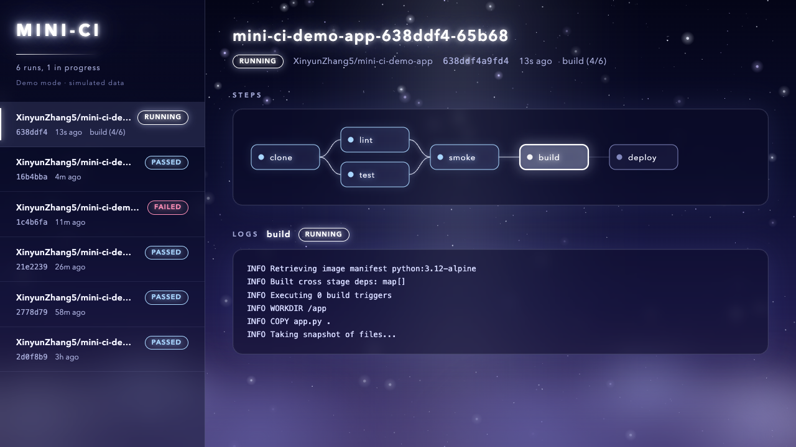

# mini-ci

A Kubernetes-native CI/CD system built from scratch: a custom resource, an operator, and a scheduler that runs each pipeline step as its own Pod.

[](https://github.com/XinyunZhang5/mini-ci/actions/workflows/ci.yml)

**English** · [中文](README.zh-CN.md) · [**Live demo**](https://xinyunzhang5.github.io/mini-ci/) (simulated data, no backend)

[](https://xinyunzhang5.github.io/mini-ci/)

## What it does

You push a commit. A webhook records it as a `PipelineRun` resource in the cluster. An operator reads the `.ci.yaml` in that commit, turns it into a dependency graph, and starts a Pod for every step whose dependencies have finished. Independent steps run in parallel. The result is written back to the `PipelineRun` and, for GitHub repositories, to the commit status.

```
git push ──▶ webhook ──creates──▶ PipelineRun ◀──writes status──┐
                                       │                         │
                                       └──watched by──▶ operator (kopf)
                                                           │ one Pod per step, shared workspace volume
                                                           ▼
                                                 ┌▶ lint ─┐
                                          clone ─┤        ├▶ smoke ▶ build (Kaniko) ▶ deploy
                                                 └▶ test ─┘
```

## Highlights

- **Declarative, like Kubernetes itself.** A run is a `PipelineRun` custom resource. `kubectl get runs -w` shows progress, and `kubectl delete run <name>` cancels it: its Pods and workspace are garbage-collected through owner references.
- **Survives operator crashes.** The operator keeps no state of its own. Kill it mid-run and the replacement picks up from what is in the cluster. An end-to-end test does exactly this.
- **DAG scheduling.** Steps declare `needs`. A failed step skips its dependents while siblings already running are allowed to finish. The scheduling decision is one pure function with unit tests ([`runstatus.py`](controller/runstatus.py)).
- **Untrusted steps get no credentials.** Steps run arbitrary commands from the repository, so their Pods mount no service account token. Only the deploy step can touch the cluster, and only one namespace of it. The GitHub token reaches the clone step alone and is never written to the workspace.
- **GitHub integration.** Reads `.ci.yaml` through the contents API, clones private repositories, and reports `pending` / `success` / `failure` as a commit status.
- **Tested end to end.** 16 unit tests and 8 end-to-end scenarios run against a real kind cluster in GitHub Actions on every push.

## Measured

Four identical jobs (`sleep 10` each), run once as a chain and once with no dependencies between them. Median of three trials on a single-node kind cluster (8-core Mac):

| | Wall time |
|---|---|
| Sequential (each step needs the previous one) | 55.2s |
| Parallel (no `needs`) | 19.1s |
| Speedup | 2.89x |

It is not 4x because every run pays fixed costs: the clone step, and about 2 seconds of scheduling latency per step (time from a step's dependencies finishing to its container starting; median 2.0s, max 3.0s over 24 samples). The jobs sleep, so this measures scheduling, not CPU-bound builds. Reproduce with `python3 scripts/bench.py`.

## Quick start

Requires Docker, [kind](https://kind.sigs.k8s.io/), and kubectl.

```bash
make up                        # kind cluster, local registry, in-cluster git server, webhook, operator
make demo                      # commit and push demo-app/, trigger a pipeline, wait for it
open http://localhost:18080    # dashboard
curl localhost:18090           # the app the pipeline just deployed
make down                      # tear everything down
```

Change `MESSAGE` in `demo-app/app.py` and run `make demo` again to watch a new version roll out. Break the test and the pipeline stops before the build, leaving the running version untouched.

## Pipeline definition

A `.ci.yaml` at the repository root:

```yaml
steps:
  - name: lint              # no `needs`: starts right after clone, in parallel with test
    image: python:3.12-alpine
    run: python -m compileall -q .
  - name: test
    image: python:3.12-alpine
    run: python -m unittest discover -v
    env: {KEY: value}       # optional
  - name: smoke
    needs: [lint, test]     # waits for both
    image: python:3.12-alpine
    run: python -c "import app"
build:                      # optional: build and push an image with Kaniko once all steps pass
  dockerfile: Dockerfile
deploy:                     # optional: kubectl apply, then wait for the rollout
  manifest: deploy.yaml     # __IMAGE__ is replaced with the image that was just built
```

A commit without this file is marked `Skipped`. Unknown fields, missing steps in `needs`, and dependency cycles are rejected before anything runs, with the reason in `status.message`.

## Working with runs

```bash
alias k='kubectl --context kind-cicd -n ci'
k get runs                    # repo, phase, current step
k get runs -w                 # follow progress
k get run <name> -o yaml      # per-step state and exit codes
k delete run <name>           # cancel
```

## Connecting a real GitHub repository

```bash
gh extension install cli/gh-webhook          # once
./scripts/github-connect.sh <owner/repo>     # runs in the foreground, Ctrl-C to stop
```

This stores your `gh` token in the cluster and uses `gh webhook forward` to relay push events to your machine, so no public endpoint is needed. Pushes to that repository then run on your local cluster and report back to the commit.

## Tests

```bash
make test    # unit tests: config parsing and scheduling, no cluster needed
make e2e     # end-to-end against the cluster from `make up`, about 2 minutes
```

The end-to-end suite covers parallelism and ordering, failure propagation, invalid and missing configuration, cancellation, operator restart mid-run, build and deploy, and webhook signature checks.

## Layout

| Path | What is in it |
|---|---|
| [`controller/reconciler.py`](controller/reconciler.py) | The operator: reconcile loop, Pod creation, status updates, history pruning |
| [`controller/runstatus.py`](controller/runstatus.py) | The scheduler: a pure function from graph plus Pod states to "what starts next" |
| [`controller/pipeline.py`](controller/pipeline.py) | Turns `.ci.yaml` into a step graph, Pods, and the workspace volume |
| [`controller/ciconfig.py`](controller/ciconfig.py) | Parses and validates `.ci.yaml` |
| [`controller/app.py`](controller/app.py) | Webhook receiver, REST API, and the dashboard |
| [`controller/github.py`](controller/github.py) | Contents API and commit statuses |
| [`manifests/`](manifests) | CRD, RBAC, and Deployments |
| [`tests/e2e.py`](tests/e2e.py) | End-to-end tests |

## Limitations

This is a learning project, not a replacement for Tekton or Argo Workflows.

- The workspace is a `ReadWriteOnce` volume, which only works on a single node. Multiple nodes would need RWX storage or artifact passing through object storage.
- One operator replica, no leader election.
- No build cache, no way to inject secrets into steps, no per-step resource overrides.
- The dashboard has no authentication. Logs live as long as the run record (the last 10 runs per repository).
- GitHub integration is for development: it relies on `gh webhook forward` and a personal token rather than a GitHub App.
- Commit status reporting is best effort and is not retried.

## License

[MIT](LICENSE)
